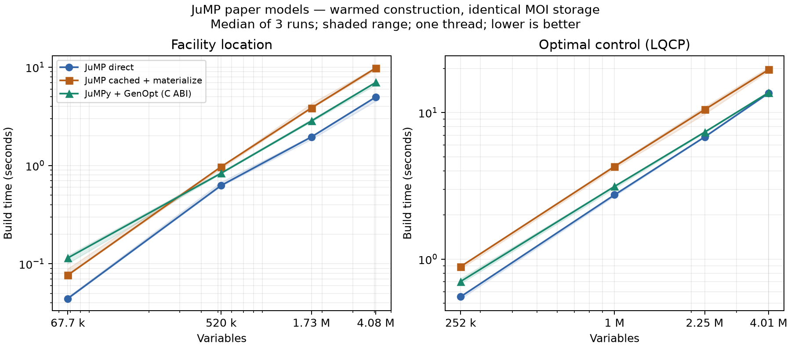

# JuMP paper benchmarks

Ports of [JuMPPaperBenchmarks at b4a3479](https://github.com/jump-dev/JuMPPaperBenchmarks/tree/b4a3479):
facility location, linear-quadratic optimal control (LQCP), and the small latency LP.
The Julia formulations are retained in `models.jl`; `models.py` expresses the
scaling cases with GenOpt iterators, constraint groups, and lazy sums.
Array bounds and integrality use bulk native calls instead of Python loops.
The facility assignment has an n-term Python loop to form one template, rather
than a Python loop over its n(n+1)² customer/facility constraints.

## Measured results

The recorded run is **construction only**, on identical MOI storage, with three
warmed repetitions per case and one thread. Cached JuMP includes materializing
its cache into that storage. String names are disabled in both frontends.
The native C-ABI image uses JuliaC with `--trim=no`; its initial compilation is
excluded from these warm timings. These are not measurements of a fully trimmed
release image or of solver performance.

The original paper also calls Gurobi with a zero time limit and presolve disabled
to include solver ingestion. That exact mode is supported by the runners, but
Gurobi rejects this sandbox's host ID (zero), so it was not measured here.

Median construction times for the largest instances:

| Model | Variables | JuMP direct | JuMPy + GenOpt | JuMP cached |
| --- | ---: | ---: | ---: | ---: |
| Facility, n = 100 | 4,080,601 | 4.97 s | 7.00 s | 9.81 s |
| LQCP, n = 2000 | 4,006,001 | 13.58 s | 13.69 s | 19.63 s |

At these sizes, JuMPy is about 1.4 times faster than cached JuMP. It is
essentially tied with direct JuMP for LQCP (their sample ranges overlap), and
41% slower for facility location. The smaller cases and all sample ranges are
included below; these are three-sample measurements on one machine.



See [all timing samples](results/storage-2026-10-31/samples.jsonl),
[summary CSV](results/storage-2026-10-31/summary.csv),
[machine and methodology](results/storage-2026-10-31/metadata.json),
[package versions and source hashes](results/storage-2026-10-31/versions.json),
and [coefficient-level validation](results/storage-2026-10-31/validation.json).
The machine was an Intel i7-12700K, with Julia 1.13.3 and JuMP 1.32.1.

The latency LP was also solved with HiGHS in five fresh processes per frontend,
each checked against objective 205. Median process wall times were **0.454 s**
for JuMPy, **2.326 s** for direct JuMP, and **2.954 s** for cached JuMP. These
compare JuMPy's prebuilt native image with ordinary Julia startup and installed
package caches. No custom JuMP sysimage was used, so this does not reproduce
the paper's custom-sysimage latency comparison. See the
[latency samples](results/latency-2026-10-31.json).

## Reproduce

From the repository root, with Julia 1.13 and Python 3.10 or newer:

```sh
julia --project=benchmarks/paper -e 'using Pkg; Pkg.instantiate()'
julia --project=benchmarks/paper/build/tools -e 'using Pkg; Pkg.add(PackageSpec(name="JuliaC", version="0.3.12"))'
python benchmarks/paper/build_native.py --backend storage --juliac-project benchmarks/paper/build/tools
python benchmarks/paper/run.py --backend storage \
  --library benchmarks/paper/build/storage/lib/libjumpy_storage.so \
  --output benchmarks/paper/results/my-storage-run
```

The runners use the repository's Python source directly; installing a wheel is
not required. Set `--repeats`, `--facility-sizes`, or `--lqcp-sizes` for a smaller
run. For example, `--facility-sizes 5 10 --lqcp-sizes 50 100` is a quick check.
The recorded package environment uses the same JuMP/GenOpt/MOI JuliaC branches
as the compiled JuMPy backend. Source hashes are retained because these branches
can move independently of package version numbers.

To reproduce the original Gurobi timing scope on a host with a matching license:

```sh
python benchmarks/paper/build_native.py --backend gurobi --juliac-project benchmarks/paper/build/tools
python benchmarks/paper/run.py --backend gurobi \
  --library benchmarks/paper/build/gurobi/lib/libjumpy_gurobi.so \
  --output benchmarks/paper/results/my-gurobi-run
```

`--backend highs` can run LQCP and the latency LP; HiGHS does not support the
facility model's quadratic constraints. Build its library with
`build_native.py --backend highs`. Linux shared-library paths above use `.so`;
use the corresponding `.dylib` path on macOS.

To measure the latency LP with HiGHS:

```sh
python benchmarks/paper/build_native.py --backend highs --juliac-project benchmarks/paper/build/tools
python benchmarks/paper/latency.py \
  --library benchmarks/paper/build/highs/lib/libjumpy_highs.so \
  --output benchmarks/paper/results/my-latency-run.json
```

## Validate a port

Export a small reference and candidate without changing the timed large runs:

```sh
julia --project=benchmarks/paper benchmarks/paper/run_jump.jl \
  --model facility --sizes 3 --repeats 1 --mode direct \
  --export /tmp/reference.mof.json
python benchmarks/paper/run_jumpy.py --backend storage \
  --library benchmarks/paper/build/storage/lib/libjumpy_storage.so \
  --model facility --sizes 3 --repeats 1 --export /tmp/candidate.mof.json
python benchmarks/paper/validate.py /tmp/reference.mof.json /tmp/candidate.mof.json
```

Repeat with `--model lqcp`. The comparison canonicalizes row order, objective
representation, variable names, and floating-point coefficients to 12 decimal
places, then checks every constraint and objective coefficient. The recorded
small facility model has 199 variables and 316 constraints; LQCP has 19 and 54.
The ports follow the paper's Julia code, including `M = 2√2` and the Julia LQCP
objective parentheses, rather than the different Pyomo expressions.

`python benchmarks/paper/plot.py <result-directory>` produces PNG and SVG
figures and requires matplotlib. Benchmark execution itself uses Python's
standard library only.
