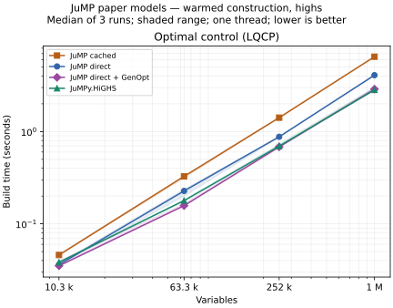

# JuMP paper benchmarks

Model-building comparisons based on
[JuMPPaperBenchmarks](https://github.com/jump-dev/JuMPPaperBenchmarks/tree/b4a3479),
using GenOpt iterators and constraint groups in JuMPy.

## Current comparison

The default benchmark runs the linear-quadratic optimal control model (LQCP)
through four frontends with the same HiGHS solver:

1. **JuMP cached**: `Model(HiGHS.Optimizer)`, including copying the cache.
2. **JuMP direct**: `concrete_direct_model(HiGHS.Optimizer())`, using JuMP macros.
3. **JuMP direct + GenOpt**: constraint templates and lazy sums built in Julia.
4. **JuMPy.HiGHS**: the same templates built in Python with `jumpy.highs`.

All four use the same dependency source snapshots. The grouped Julia and
Python paths also share the direct adapter and GenOpt expansion code.

See the [current table](results/highs-2026-11-01/table.md) and
[build and environment details](results/highs-2026-11-01/metadata.json).
The **Python / grouped Julia** column divides their median times; values above
1 mean JuMPy took longer.



String names are disabled and all runtimes and solvers use one thread.
Timings include model construction and solver ingestion, with presolve disabled
and a zero solve time limit. Compilation, warm-up, explicit garbage collection
before each sample, and model disposal are excluded.

The recorded run and the benchmark helper use JuliaC with `--trim=no`.
The normal JuMPy build uses `--trim=unsafe-warn`; these timings were collected
with the separate untrimmed benchmark library.

## Run

From the repository root, with Julia 1.13 and Python 3.10 or newer:

```sh
julia --project=benchmarks/paper -e 'using Pkg; Pkg.instantiate()'
julia --project=benchmarks/paper/build/tools -e 'using Pkg; Pkg.add(PackageSpec(name="JuliaC", version="0.3.12"))'
python benchmarks/paper/build_native.py --juliac-project benchmarks/paper/build/tools
python benchmarks/paper/run.py \
  --library benchmarks/paper/build/highs/lib/libjumpy_highs.so \
  --output benchmarks/paper/results/my-highs-run
```

The default sizes are n = 100, 250, 500, 1000, with three warmed samples each.
For a quick run, add `--lqcp-sizes 10 25 --repeats 2`. Use `--frontends` to select
a subset of `jump-cached jump-direct jump-genopt jumpy`. The runner uses the
repository's Python source directly, so installing a wheel is unnecessary.

HiGHS cannot accept the facility model's quadratic constraints. That model
requires a matching library built with `--backend gurobi` or `--backend storage`;
pass the same backend to the runner. Storage measures MOI construction without
a solver. Library paths above use Linux's `.so` suffix; use `.dylib` on macOS.

## Reports

The output directory contains individual samples in `samples.jsonl`, summary
statistics in `summary.csv`, and the environment and build metadata.
The runner also generates `table.md` for a README and Mermaid bar charts in
`charts.md`.

Regenerate these from an existing CSV:

```sh
python benchmarks/paper/report.py benchmarks/paper/results/my-highs-run/summary.csv \
  --output benchmarks/paper/results/my-highs-run/table.md \
  --mermaid benchmarks/paper/results/my-highs-run/charts.md
```

For SVG and PNG plots, install `matplotlib` and add `--plot` to the runner, or run:

```sh
python benchmarks/paper/plot.py benchmarks/paper/results/my-highs-run
```

## Validate a model

Export a small Julia reference and Python candidate, then compare their
constraints and objective coefficients:

```sh
julia --project=benchmarks/paper benchmarks/paper/run_jump.jl \
  --backend highs --model lqcp --sizes 3 --repeats 1 --mode direct \
  --export benchmarks/paper/build/reference.mof.json
python benchmarks/paper/run_jumpy.py --backend highs \
  --library benchmarks/paper/build/highs/lib/libjumpy_highs.so \
  --model lqcp --sizes 3 --repeats 1 \
  --export benchmarks/paper/build/candidate.mof.json
python benchmarks/paper/validate.py \
  benchmarks/paper/build/reference.mof.json \
  benchmarks/paper/build/candidate.mof.json
```

The comparison ignores row order and variable names and rounds coefficients
to 12 decimal places. Use `--mode genopt` to check the grouped Julia formulation.
